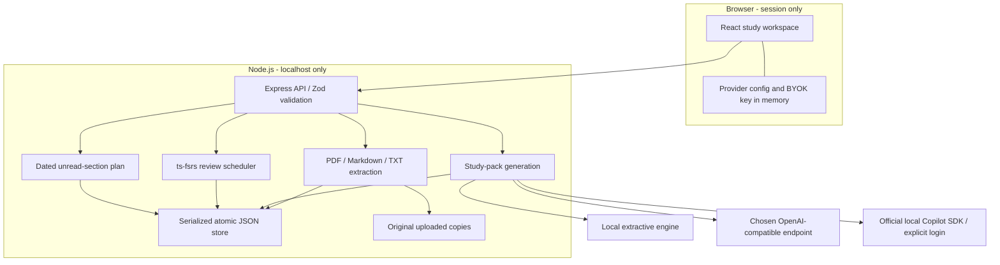
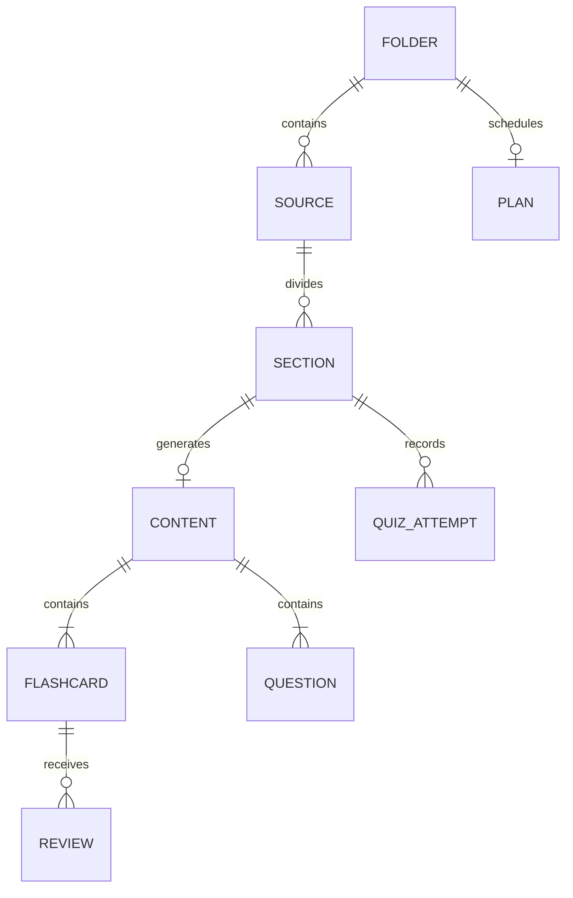

# Architecture

## Boundaries

## Data Model

UUIDs identify all independently persisted records. Sources preserve original names, kinds and file references. Sections preserve extracted text and PDF page ranges. Content preserves provider/model/time and separates source-grounded output from model supplements. Each card stores serialized FSRS state with ISO date strings. Attempts store selected answers and server-computed scores. A folder plan stores target date, daily minutes, dated section IDs, daily review minutes, and optional overload warnings.

Reading completion, review history, and quiz scores are separate signals; the interface does not claim a mastery percentage based only on clicks. The percentage shown in the progress ring is explicitly **reading progress**.

## Flows

### Import

Workspace discovery lists direct, nonhidden source folders, skipping code, caches and data directories. Supported regular files are PDF, Markdown and TXT. Import rejects traversal, excluded folders, and out-of-workspace symlinks. Uploads are memory-limited (12 files, 60 MB each). Extraction completes before metadata is added to the study store. Uploaded copies use generated filenames. A failed batch may leave orphaned copies but never partial source metadata.

Markdown/text divides on headings, then safe bounded chunks. PDFs group pages at approximately 4,000 extracted characters, retaining page ranges. Repeated lines are excluded when choosing section titles, reducing header/footer pollution. PDF text layout and chapter inference are deliberately not claimed.

### Generation

The browser sends one section's provider configuration plus an optional key header. The server reads source text from local storage; the client cannot replace another section's context. Offline mode extracts source statements and creates cloze practice. BYOK makes a server-side request with a two-minute timeout. Copilot creates an isolated SDK session with tools disabled and permission requests denied, then disconnects and stops the runtime.

Model JSON must match Zod's summary/key-points/card/quiz contract. Multiple-choice questions require four distinct choices. Failure leaves the previous content intact. Successful cards receive fresh FSRS schedules. A section with existing study history cannot be regenerated, avoiding accidental loss of review state. Per-section generation locks prevent duplicate concurrent jobs within one process. This is not a multi-user transaction or queue system.

### Scheduling

FSRS is the established memory scheduler used for card due dates. User grades map directly to Again (1), Hard (2), Good (3), Easy (4). The API rejects cards that are not due. It persists both card state and review records in one store update.

Study planning is intentionally simpler: each unread section costs 15 minutes; daily review reserves approximately 25% of the selected budget. All unread sections are assigned once before the exam, over-budget plans show a warning, and remaining days still reserve review time. Plans include topic-only sections as well as uploaded-source sections. They do not yet use quiz accuracy to rebalance work.

## API Map

| Method | Route                                    | Purpose                             |
| ------ | ---------------------------------------- | ----------------------------------- |
| GET    | `/api/health`                            | Server health                       |
| GET    | `/api/state`                             | Complete single-user workspace      |
| GET    | `/api/export`                            | Download JSON study snapshot        |
| GET    | `/api/workspace-folders`                 | Discover importable source folders  |
| POST   | `/api/import-workspace`                  | Import one direct workspace folder  |
| POST   | `/api/folders`                           | Create subject                      |
| DELETE | `/api/folders/:id`                       | Delete active subject data/progress |
| POST   | `/api/folders/:id/upload`                | Multipart `files` upload            |
| POST   | `/api/folders/:id/topic`                 | Generate model-knowledge topic      |
| PUT    | `/api/folders/:id/plan`                  | Build/rebuild dated plan            |
| GET    | `/api/sources/:id/file`                  | Original source binary/text         |
| PATCH  | `/api/sections/:id`                      | Toggle reading completion           |
| POST   | `/api/sections/:id/generate`             | Generate complete study pack        |
| POST   | `/api/sections/:id/cards/:cardId/review` | Record due-card grade               |
| POST   | `/api/sections/:id/quiz`                 | Score and save complete quiz        |

No API route accepts an arbitrary filesystem path. JSON exports and state include quiz answers by design: this is a personal learning app, not an adversarial exam platform.

## Persistence And Operations

The store serializes updates, writes a temporary file, then atomically renames it over the previous JSON file. A failed mutation does not write new state. Invalid JSON is not silently overwritten. One process owns each data directory; no cross-process locking or schema migration engine exists yet.

The server resolves its workspace root from its module location, not an arbitrary caller directory. `FOLIO_DATA_DIR` may choose a directory beneath the project for isolated testing; paths outside the project are rejected. API and frontend bind to loopback. The Vite proxy points to the configured API `PORT`; the production Node server serves built assets from `dist/`.

## Evolution

Recommended next iterations: editable study packs and explicit versioned regeneration; learning objectives/chapter-aware extraction; weak-topic-aware replanning; a cross-section review queue; progress-aware batch generation with spend limits; SQLite transactions and schema migrations; validated in-app backup restoration; OCR. Add accounts and deployment controls only when intentionally moving beyond local single-user operation.
