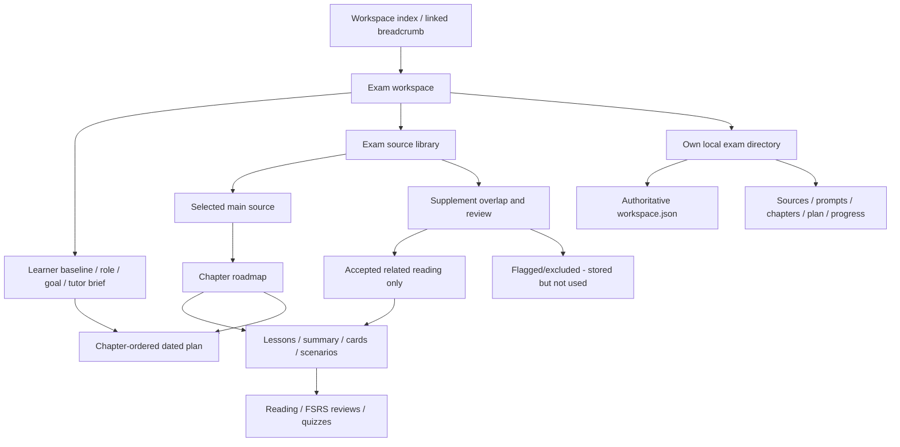

# Exam Workspace Architecture

## Ownership

The exam is the ownership boundary, not the PDF. All entities carry the exam ID. Exactly one source can define its active curriculum; supplementary files never independently append curriculum chapters. The state API aggregates exam snapshots for the browser, but persistence is physically exam-scoped.

## Data And Storage

`Folder` is retained as the internal exam-workspace type for compatibility. It owns `mainSourceId`, learner settings, custom prompt, directory, curriculum revision and plan. `Chapter` owns its ordered title, main-source page range and description. Sections are lesson units linked to chapters. Source fragments are archived internal extraction records, not visible lessons. Historical lessons retain IDs, schedules and attempts after a revision.

Original files use server-generated names beneath each exam's `sources/`. Canonical `workspace.json` contains its source metadata, chapters, source fragments, lessons, schedules, reviews, attempts and plan. `plan.json`, `progress.json`, `prompts/study.md` and chapter files are readable projections; the application does not watch manual projection edits.

The active index is `data/exams/index.json`. If absent, the store reads the legacy `data/study.json`; the next mutation writes exam directories and copies legacy source binaries without overwriting the old file. A missing indexed workspace is an error, never silently replaced by empty state. There is no cross-process lock or atomic multi-file commit: one server owns each data directory.

## Curriculum Rules

1. First source is main by default. The learner can choose a different source from this exam only.
2. The supplied AWS slide deck is identified by its SHA-256 fingerprint. Its 28 chapter dividers are mapped to actual PDF page ranges, starting at IAM on page 24. Introductory slides are not falsely described as exam topic chapters.
3. Lesson and assessment counts follow authored objectives, not a fixed quota. The reference pack currently has 63 lessons, 143 concise cards and 63 application questions. IAM has nine source-audited topic areas; other chapter inventories remain explicitly draft.
4. Generic Markdown groups H2/H3 sections under their H1 chapter. Other sources use explicit Chapter/Domain/Part boundaries when present. An unreliable outline is labelled provisional; arbitrary exam questions are not fabricated.
5. Main-source changes require explicit confirmation. Active lessons are archived, chapter records are replaced and the dated plan is invalidated. Historical records are retained.
6. No current route invokes an AI provider. Old provider modules remain unused by the active product flow. Per-section cloze generation is retired.

`server/tutor/catalog.ts` owns source-fingerprint lookup; the curriculum builder operates on the selected pack, and `shared/learning.ts` operates only on objectives and assessment evidence. Non-AWS circuit-learning tests exercise the same completion and planning rules. Content-specific examples belong in the catalog, never in preparation thresholds or baseline policies.

`Chapter.objectives` is an explicit main-source inventory. Cards/questions list `objectiveIds`; the UI distinguishes assessment coverage from learner demonstration. An unaudited chapter cannot claim preparation even when all its current questions are passed. IAM was checked against PDF pages 24-40, not inferred to be complete from its card count. This remains a limited authored assessment, not official or validated exam readiness.

## Supplement Commonness

The overlap algorithm normalizes English vocabulary, removes general study/document words and compares a supplement's top distinctive terms to the main-source vocabulary. The score is shared candidate terms divided by candidate terms. Automatic acceptance requires a score of at least 0.16 plus a minimum shared-term count. This favors a narrow relevant supplement even if the main book is large.

The score is not calibrated semantic certainty. A supplement can pass vocabulary overlap yet contain incorrect claims; an unusual or multilingual source can fail despite relevance. Flagged sources are stored but excluded. Explicit acceptance/exclusion is recorded as a learner override; changing the main source resets those judgments for reassessment.

Accepted supplements are searched for chapter-topic overlap. Only matching references are attached as related reading. Exclusion immediately removes links, without replacing lesson/card IDs or destroying progress. This iteration does not dynamically rewrite tutor-authored lessons to incorporate every new document or resolve contradictions automatically.

## Personalization And Plan

The verified RemNote baseline labels are documented in its public [Guided Learn Mode](https://help.remnote.com/en/articles/15724936-guided-learn-mode) article. Folio's explicit policy is summary/cards/quiz first for new/basic/refresh respectively, with estimated lesson minutes 25/15/10 and review reserves 25%/35%/45%. These are product defaults, not validated measurements. Familiarity changes automatically replan an existing schedule without regenerating assessments. Role changes alone do not replan; role, goal and the brief remain context only. There is no active prompt execution.

FSRS owns due dates. Reading is an independent marker. Chapter preparation requires an audited nonempty inventory, required recall/application mappings, successful latest card grades (Good/Easy) for every card, and all correct answers in the latest lesson quiz. Later failures can reopen it. The remaining-work planner uses practice rather than read markers, spreads work over the first 80% of days and reserves the rest for review. Reviews and quiz attempts refresh an existing plan; a passed/today exam date prompts date correction instead of implying completion. Incomplete source audits produce a plan warning. The visible 80%-quiz attention hint is separate from the stricter preparation rule.

## API Map

| Route                                         | Contract                                                                                            |
| --------------------------------------------- | --------------------------------------------------------------------------------------------------- |
| `GET /api/state`                              | Aggregate active-exam snapshots, including archived records                                         |
| `GET /api/workspace-folders`                  | Direct importable source folders inside the project                                                 |
| `POST /api/workspaces/upload`                 | Create an exam from first multipart upload and learner fields                                       |
| `POST /api/folders`                           | Create an empty exam with learner settings                                                          |
| `POST /api/import-workspace`                  | Import an existing local source folder                                                              |
| `POST /api/folders/:id/upload`                | Add files to the existing exam directory; return relevance warnings                                 |
| `PATCH /api/folders/:id`                      | Save learner settings and exam brief                                                                |
| `PUT /api/folders/:id/main-source`            | Same-exam source ID plus `confirmRebuild: true`                                                     |
| `PATCH /api/folders/:id/sources/:sourceId`    | Explicitly accept or exclude a supplement                                                           |
| `POST /api/folders/:id/prepare`               | Upgrade legacy sources and build an exam curriculum                                                 |
| `POST /api/folders/:id/refresh-materials`     | Confirmed idempotent methodology upgrade; archive old practice, preserve the target date and replan |
| `PUT /api/folders/:id/plan`                   | Dated chapter-associated plan using the saved baseline                                              |
| `GET /api/sources/:id/file`                   | Original file from its exam directory                                                               |
| `PATCH /api/sections/:id`                     | Reading-completion state                                                                            |
| `POST /api/sections/:id/cards/:cardId/review` | Due-card FSRS grade                                                                                 |
| `POST /api/sections/:id/quiz`                 | Score a complete quiz server-side                                                                   |
| `GET /api/export`                             | JSON backup, including archived records but no binary files                                         |
| `DELETE /api/folders/:id`                     | Remove active index records; retain on-disk directory                                               |

The old generation route returns an existing tutor pack unchanged or an explicit paused/retired error; it never regenerates cloze filler. Topic-only generation returns a paused error.

## Deliberate Limits

Localhost only, no auth/profiles, no OCR, no external file paths, no public deployment, no automatic semantic chapter generation for arbitrary textbooks, no live tutor chat, no adaptive model prompt execution, no background generation queue, no cross-process transactions. These remain explicit future phases rather than simulated features.
