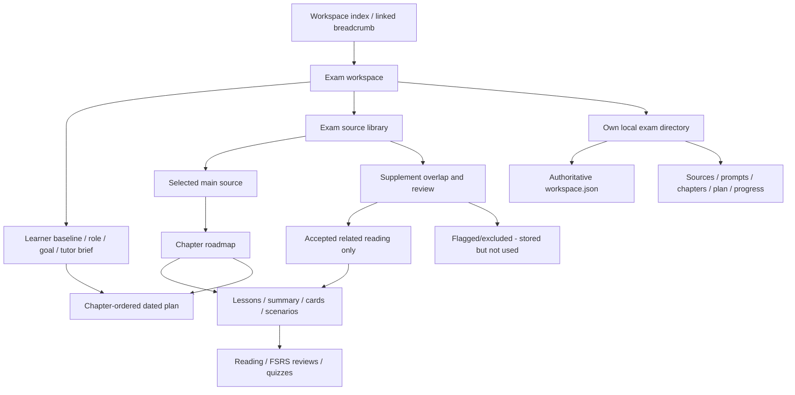

# Exam Workspace Architecture

## Ownership

The exam is the ownership boundary, not the PDF. All entities carry the exam ID. Exactly one source can define its active curriculum; supplementary files never independently append curriculum chapters. The state API aggregates exam snapshots for the browser, but persistence is physically exam-scoped.

## Data And Storage

`Folder` is retained as the internal exam-workspace type for compatibility. It owns `mainSourceId`, learner settings, custom prompt, directory, curriculum revision and plan. `Chapter` owns its ordered title, main-source page range and description. Sections are lesson units linked to chapters. Source fragments are archived internal extraction records, not visible lessons. Historical lessons retain IDs, schedules and attempts after a revision.

Original files use server-generated names beneath each exam's `sources/`. Canonical `workspace.json` contains its source metadata, chapters, source fragments, lessons, schedules, reviews, attempts, generation requests and plan. `plan.json`, `progress.json`, `prompts/study.md`, `generation/<requestId>.prompt.md` / `.response.json` and chapter files are readable projections; the application does not watch manual projection edits.

The active index is `data/exams/index.json`. If absent, the store reads the legacy `data/study.json`; the next mutation writes exam directories and copies legacy source binaries without overwriting the old file. A missing indexed workspace is an error, never silently replaced by empty state. There is no cross-process lock or atomic multi-file commit: one server owns each data directory.

## Curriculum Rules

1. First source is main by default. The learner can choose a different source from this exam only.
2. The supplied AWS slide deck's table of contents (pages 3-5) yields a 30-chapter outline; the exam guide's SAA-C03 task statements attach to each chapter as exam focus.
3. Chapter sections and their key-topic inventory, flashcards and quizzes are produced by the prompt pipeline, not by fixed quotas or code. The AWS example has chapters 1-2 generated as a worked example; the rest generate on request.
4. Generic Markdown groups H2/H3 sections under their H1 chapter. Other sources use explicit Chapter/Domain/Part boundaries when present. An unreliable outline is labelled provisional; arbitrary exam questions are not fabricated.
5. Main-source changes require explicit confirmation. Active lessons are archived, chapter records are replaced and the dated plan is invalidated. Historical records are retained.
6. Generation is request/response via files. A request writes the rendered prompt; the response is written by `pnpm tutor run` (any configured model) or by hand, and is validated before application.

`server/tutor.ts` renders versioned prompts from `prompts/*.md`, queues requests and validates/applies responses. Raw model output is normalized per artifact kind (`shared/normalize.ts`) before schema validation, so a provider only has to speak its own API — not Folio's exact JSON shape. `shared/artifacts.ts` owns the schemas and coverage/quality checks. `server/curriculum.ts` produces the provisional outline. `shared/learning.ts` operates only on key-topic coverage and assessment evidence; exam-specific content never appears in preparation thresholds or baseline policies. Section labels like `3.2` are derived in `shared/sections.ts`.

`server/ai/model.ts` is the single AI import surface. `AiModel.create(id?)` resolves a registry entry (id → provider, base URL, model name, key env var, JSON-mode support), throws when the key is missing, and exposes `complete({ prompt })`. Providers sit behind an `AiProvider` interface so tests inject a mock and new vendors register in one place; `GET /api/models` serves the picker list and a `configured` flag, never the key. `pnpm tutor run` uses the same class and then writes a normal response file, so generated output passes the same validation as hand-written output.

Each exam can pin a model (`Folder.modelId`, chosen in Exam settings). Every generated artifact records its provenance — the model id, learning baseline and source curriculum revision — in `ArtifactMeta`. The UI offers **Regenerate** only when the current settings differ from that provenance, so regenerating identical content under identical settings is never offered (and never wastes a call). A startup migration backfills provenance for materials generated before model selection existed.

`Section.keyTopics` is the main-source topic inventory. Cards/quiz questions list the key topics they cover; the UI distinguishes assessment coverage from learner demonstration. An unaudited section cannot claim preparation even when all its current questions are passed. IAM was generated against PDF pages 24-40, not inferred to be complete from its card count. This remains a limited authored assessment, not official or validated exam readiness.

## Supplement Commonness

The overlap algorithm normalizes English vocabulary, removes general study/document words and compares a supplement's top distinctive terms to the main-source vocabulary. The score is shared candidate terms divided by candidate terms. Automatic acceptance requires a score of at least 0.16 plus a minimum shared-term count. This favors a narrow relevant supplement even if the main book is large.

The score is not calibrated semantic certainty. A supplement can pass vocabulary overlap yet contain incorrect claims; an unusual or multilingual source can fail despite relevance. Flagged sources are stored but excluded. Explicit acceptance/exclusion is recorded as a learner override; changing the main source resets those judgments for reassessment.

Accepted supplements are searched for chapter-topic overlap. Only matching references are attached as related reading. Exclusion immediately removes links, without replacing lesson/card IDs or destroying progress. This iteration does not dynamically rewrite tutor-authored lessons to incorporate every new document or resolve contradictions automatically.

## Personalization And Plan

The verified RemNote baseline labels are documented in its public [Guided Learn Mode](https://help.remnote.com/en/articles/15724936-guided-learn-mode) article. Folio's explicit policy is summary/cards/quiz first for new/basic/refresh respectively, with estimated lesson minutes 25/15/10 and review reserves 25%/35%/45%. These are product defaults, not validated measurements. Familiarity changes automatically replan an existing schedule without regenerating assessments. Role changes alone do not replan; role, goal and the brief are injected into generation prompts as context only. Nothing executes automatically: generation is queued by the learner and answered out-of-band.

FSRS owns due dates. Reading is an independent marker. Chapter preparation requires an audited nonempty inventory, required recall/application mappings, successful latest card grades (Good/Easy) for every card, and all correct answers in the latest lesson quiz. Later failures can reopen it. The remaining-work planner uses practice rather than read markers, spreads work over the first 80% of days and reserves the rest for review. Reviews and quiz attempts refresh an existing plan; a passed/today exam date prompts date correction instead of implying completion. Incomplete source audits produce a plan warning. The visible 80%-quiz attention hint is separate from the stricter preparation rule.

## API Map

| Route                                         | Contract                                                                                            |
| --------------------------------------------- | --------------------------------------------------------------------------------------------------- |
| `GET /api/state`                              | Aggregate active-exam snapshots, including archived records                                         |
| `GET /api/workspace-folders`                  | Direct importable source folders inside the project                                                 |
| `POST /api/workspaces/upload`                 | Create an exam from first multipart upload and learner fields                                       |
| `POST /api/folders`                           | Create an empty exam with learner settings                                                          |
| `POST /api/import-workspace`                  | Import an existing local source folder                                                              |
| `POST /api/folders/:id/upload`                | Add files to the existing exam directory; return relevance warnings                                 |
| `PATCH /api/folders/:id`                      | Save learner settings and exam brief                                                                |
| `PUT /api/folders/:id/main-source`            | Same-exam source ID plus `confirmRebuild: true`                                                     |
| `PATCH /api/folders/:id/sources/:sourceId`    | Explicitly accept or exclude a supplement                                                           |
| `GET /api/prompts`                            | List versioned generation prompts                                                                    |
| `GET /api/models`                             | Supported AI models, default id and credential-present flags (never key values)                       |
| `POST /api/folders/:id/requests`              | Queue an outline request                                                                            |
| `POST /api/chapters/:id/materials`            | Queue summary/flashcards/quiz requests for a chapter's sections                                      |
| `GET /api/requests/:id/prompt`                | The rendered prompt text for a request                                                               |
| `POST /api/requests/:id/ingest`               | Validate and apply a request's response file                                                         |
| `POST /api/folders/:id/requests/ingest`       | Ingest every response file present for a folder                                                      |
| `DELETE /api/requests/:id`                    | Cancel a pending request                                                                             |
| `PUT /api/folders/:id/plan`                   | Dated chapter-associated plan using the saved baseline                                              |
| `GET /api/sources/:id/file`                   | Original file from its exam directory                                                               |
| `PATCH /api/sections/:id`                     | Reading-completion state                                                                            |
| `POST /api/sections/:id/cards/:cardId/review` | Due-card FSRS grade                                                                                 |
| `POST /api/sections/:id/quiz`                 | Score a complete quiz server-side                                                                   |
| `GET /api/export`                             | JSON backup, including archived records but no binary files                                         |
| `DELETE /api/folders/:id`                     | Remove active index records; retain on-disk directory                                               |

Generation requests are one artifact per request (outline, sections, summary, flashcards, quiz). A request renders the prompt to disk; ingesting validates the written response and applies it, superseding earlier pending requests for the same target.

## Deliberate Limits

Localhost only, no auth/profiles, no OCR, no external file paths, no public deployment, no automatic semantic chapter generation for arbitrary textbooks, no cross-process transactions. Model calls are opt-in per request (`pnpm tutor run` or the UI's generate/regenerate action) rather than a background queue. These remain explicit future phases rather than simulated features.
