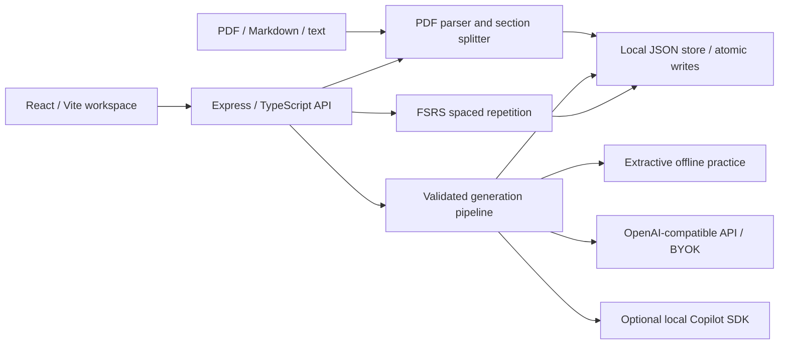

# Folio MVP Implementation Plan

## Product

A local-first, single-user study workspace inspired by RemNote's source-to-practice workflow. Original branding and interface; no copied proprietary code or assets. The first real dataset is the AWS Certified Solutions Architect Associate folder. PDFs and archives stay untracked.

## Architecture



## Structure

```text
server/       API, document ingestion, generation, persistence
shared/       Validated models and browser/server contracts
src/          React study workspace and styles
tests/        Unit, API, and browser workflow tests
docs/         Architecture, decisions, implementation record
data/         Ignored local study data and uploaded sources
AWS .../      Existing user source materials, unchanged
```

## Stack And Decisions

- Node.js 24, TypeScript strict, pnpm, React 19, Vite, Express 5.
- pdf-parse for text PDFs; heading-based sections for notes, page groups for PDFs. Page references remain visible. OCR is outside this MVP.
- Zod validates API input and generated study content. Never execute uploaded content.
- JSON persistence with serialized atomic writes: no Docker or database needed for one local user. Migrate to SQLite/Postgres if concurrency grows.
- ts-fsrs implements established spaced repetition instead of a handmade algorithm.
- OpenAI-compatible BYOK endpoint supports hosted providers and local compatible servers. Keys stay in browser memory and request headers only, never persisted or logged.
- Optional official GitHub Copilot SDK uses explicitly configured local credentials; never extract VS Code session tokens. Live usage depends on login, entitlement, quota, and model availability. Tool execution is denied.
- Offline extractive mode is useful without credentials but is not LLM generation. All output records provenance. AI supplements are distinct from uploaded evidence.
- Localhost only. No auth, billing, multi-user access, cloud deployment, or public exposure.
- Tests, strict type checking, lint, build, and desktop/mobile browser checks gate completion.

## Stages

✅ 1. Foundation: architecture, project setup, PDF extraction and section tests.
✅ 2. Study engine: folder import, uploads, study plans, validated generation, FSRS, progress, persistence, API tests.
✅ 3. Study workspace: library, section reader, cards, quizzes, plan calendar, progress, provider settings, responsive UI.
🟡 4. Verification: real PDF import, complete browser workflows, lint/typecheck/tests/build, screenshots, README and stage commits.

## MVP Acceptance

- Create multiple study folders; import existing workspace folders without reading outside the project; upload PDF/MD/TXT.
- Inspect sources and section text, generate per-section summaries, flashcards and multiple-choice quizzes.
- Set exam date and daily budget; receive a dated section plan with review capacity and overload warnings.
- Read summaries, grade due flashcards, answer quizzes, and retain progress across reloads.
- Topic-only generation uses model knowledge without uploaded sources; supplement mode labels model knowledge explicitly.
- No credentials required for offline study; clear provider errors without destroying previous content.
- Initialize Git, commit completed stages, leave remote configuration to the user.

## Deferred

OCR, document annotation, nested outline editing, collaboration, accounts, cloud sync, image occlusion, background worker queues, vector retrieval, PDF layout-aware chapter extraction, streaming generation, production deployment and hardening.

## Implementation Record

- Foundation verified with four sectioning tests, strict compilation and lint. pnpm 12 uses workspace YAML for local store configuration and build approvals. The initial install used the existing machine store before this was corrected; no global package was installed.
- Both actual user PDFs parsed: exam guide 30 pages / 9 sections / 40,991 characters; slide deck 879 pages / 100 sections / 426,553 characters. Original files remain unchanged and untracked.
- Engine tests cover offline generation, model-output validation, FSRS state, plan overload, serialized persistence and end-to-end HTTP study workflow. Keys are never part of persisted data.
- Copilot integration uses the installed SDK's empty mode, no tools, denied permissions, skipped repository instructions, and workspace-local Copilot home. No live login or paid call was attempted.